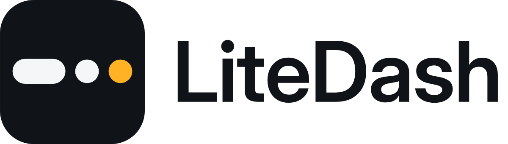

<p align="center">
  <picture>
    <source media="(prefers-color-scheme: dark)" srcset="brand/png/litedash-horizontal-sobre-oscuro.png">
    
  </picture>
</p>

<p align="center">
  <b>El launcher para pantallas Android de auto y moto: 2.2 MB con navegación sin conexión, escáner OBD2, presión de llantas, radio FM y música USB.</b><br>
  <i>The car launcher for Android head units: 2.2 MB with offline navigation, an OBD2 scanner, TPMS, FM radio and USB music.</i><br><br>
  <b>Android 6.0+ · Gratis · Sin anuncios · GPL-3.0</b><br><br>
  <a href="https://litedash.dev/">Sitio</a> ·
  <a href="https://play.google.com/store/apps/details?id=com.irvingguerra.litedash">Google Play</a> ·
  <a href="https://github.com/IrvingGuerra/litedash/releases/latest">Descargar APK</a> ·
  <a href="https://litedash.dev/compare/">Comparativa</a> ·
  <a href="https://litedash.dev/en/">English</a>
</p>

<p align="center">
  <a href="https://github.com/IrvingGuerra/litedash/stargazers"></a>
  <a href="https://github.com/IrvingGuerra/litedash/releases"></a>
  <a href="https://github.com/IrvingGuerra/litedash/releases/latest"></a>
</p>

<p align="center">
  <b>⭐ ¿Te sirve? Dale una estrella arriba a la derecha:</b> ayuda a que más gente lo encuentre.<br>
  <i>Like it? Star the repo (top right): it helps more people find it.</i>
</p>

<p align="center">
  <a href="https://ko-fi.com/irvingguerradev"></a>
</p>

---

## Qué es

LiteDash es la pantalla de inicio (launcher) para las pantallas Android de autos y motos
(*head units*, las "chinas" de 7" a 11"), tablets y teléfonos. **En 2.2 MB trae navegación sin
conexión, escáner OBD2, presión de llantas, la radio FM de tu pantalla, reproductor USB,
velocímetros y tu auto en 3D.** Todo es opcional y viene apagado, para que vuele hasta en una pantalla de 1 GB de RAM: lo
apagado no gasta memoria, batería ni permisos. Tú acomodas tu inicio: deja presionado para mover,
agrandar o quitar widgets.

## Qué trae

| | |
| --- | --- |
| **Navegación sin conexión** (nuevo en 1.5) | Baja tu estado o una zona y busca, traza tu ruta y síguela vuelta por vuelta con tu auto en 3D: ruta azul, edificios en 3D y tu música junto al mapa. Sin internet, sin claves de API ni cuentas. Mapas de OpenStreetMap (hoy México por estado; [pide tu país](https://github.com/IrvingGuerra/litedash/issues) o desde la app). |
| **Escáner OBD2** (Taller) | Adaptador ELM327 por Bluetooth, BLE, Wi‑Fi o USB. Salud del auto, códigos de falla explicados y borrarlos, monitores de verificación, gráficas en vivo, 0 a 100 y registro de viajes. Sin otra app. |
| **Presión de llantas (TPMS)** | Kits con receptor USB, sensores Bluetooth comunes o la presión de fábrica por OBD en algunos autos. Avisos de presión baja, fuga, calor y pila. |
| **Radio FM de tu pantalla** | Controla la radio de fábrica (TopWay, NWD, Hengchen) desde su widget, y radio por internet con las estaciones cerca de ti. |
| **Música** | Reproductor USB propio (carpetas, artistas, álbumes), Bluetooth con carátula y tu app (Spotify, YouTube Music…). |
| **Mapa** | Tu posición en vivo, plano o inclinado, con brújula; de fondo en tu inicio; y Waze o Google Maps a un toque. |
| **Velocímetros y medidores** | Por OBD o GPS: esfera, aguja, digital, barra o degradado; tacómetro, temperatura, gasolina, batería, turbo. |
| **Tu auto en 3D** | Catálogo de 19 modelos, del color que quieras, con giro de 360°. |
| **Tu inicio** | Widgets que se mueven y crecen, hasta 5 páginas, tarjetas de vidrio con tus colores, barra de apps a tu manera, plantillas para 7", 10" y 11", mandos al volante, día y noche por hora, sensor de luz o faros, pantalla dividida. |
| **23 idiomas** | Español e inglés incluidos y 21 más que se descargan desde la app. |
| **Android Auto y CarPlay** | Zlink, AutoKit, CarLink u Open Headunit a un toque. |
| **App del celular** | [LiteDash Connect](https://litedash.dev/connect/) (opcional): lo que suena en tu celular, con carátula y controles. |

¿Cómo se compara con StradaOS, AGAMA o CarWebGuru? → [litedash.dev/compare](https://litedash.dev/compare/)

## What it is (English)

LiteDash is a home screen (launcher) for Android car and motorcycle head units, tablets and phones.
**In 2.2 MB it packs offline turn-by-turn navigation, an OBD2 scanner, TPMS tire pressure, your
unit's factory FM radio, its own USB music player, speedometers and your car in 3D.** Everything is optional and off by
default, so it stays fast on 1 GB units running Android 6.0 or newer. No ads, no tracking, no
account. See the [comparison with other car launchers](https://litedash.dev/en/compare/).

## Instalar / Install

1. Bájalo de [Google Play](https://play.google.com/store/apps/details?id=com.irvingguerra.litedash)
   o el APK de [Releases](https://github.com/IrvingGuerra/litedash/releases/latest). El APK se
   actualiza solo desde Ajustes → Acerca de y ayuda → Acerca de.
2. Ábrelo y toca **Hazlo tu inicio**. En muchas pantallas de auto esto también está en Ajustes →
   Aplicaciones → Pantalla de inicio, o en un menú del fabricante para elegir el launcher.

Requiere Android 6.0 o más nuevo. *Requires Android 6.0+.*

**¿Te sirve? Dale una ⭐ al repo:** ayuda a que más gente lo encuentre. *Like it? Star the repo.*

## Compilar / Build

JDK 17 y el SDK de Android con la plataforma 37.

```bash
./gradlew assemblePlayDebug        # versión para Google Play, depuración
./gradlew assembleGithubRelease    # APK para GitHub
tools/avd.sh                       # emuladores de pantallas de auto (1024×600 a 2000×1200)
tools/spin.sh                      # qué tan fluido gira el auto (cuadros por segundo)
tools/measure.sh                   # medir arranque, memoria y fluidez en un equipo conectado
```

Hay dos variantes del mismo código: `play` (Google Play, sin permiso de
internet) y `github` (APK; usa internet solo cuando tocas "Buscar
actualizaciones" en Ajustes, para bajar e instalar la versión nueva).

## Contribuir / Contributing

Lee [`CONTRIBUTING.md`](CONTRIBUTING.md). Los reportes de pantallas, sensores y
cajas CAN son de lo más útil.

## Licencia / License

Código bajo [GPL-3.0](LICENSE). El nombre y el logo de LiteDash no están
incluidos en esa licencia. *The LiteDash name and logo are not covered by the
code license.*

Las recetas para leer la presión de llantas de fábrica por OBD
(`feature/obd/.../FactoryTires.kt`) son derivadas de [OBDb](https://github.com/OBDb),
[CC BY-SA 4.0](https://creativecommons.org/licenses/by-sa/4.0/), adaptadas. *The factory
tire-pressure recipes are derived from OBDb (CC BY-SA 4.0), adapted.*

El control de la radio FM de las pantallas NWD y Hengchen (`feature/music/.../NwdRadio.kt`, `HcnRadio.kt`) usa
la información de [OpenRadioFM](https://github.com/kapi21/OpenRadioFM) (Apache-2.0) y de
[Radio+](https://github.com/edman01/radio-plus-open) (MIT). *NWD and Hengchen FM radio control is based on
information from OpenRadioFM (Apache-2.0) and Radio+ (MIT).*
